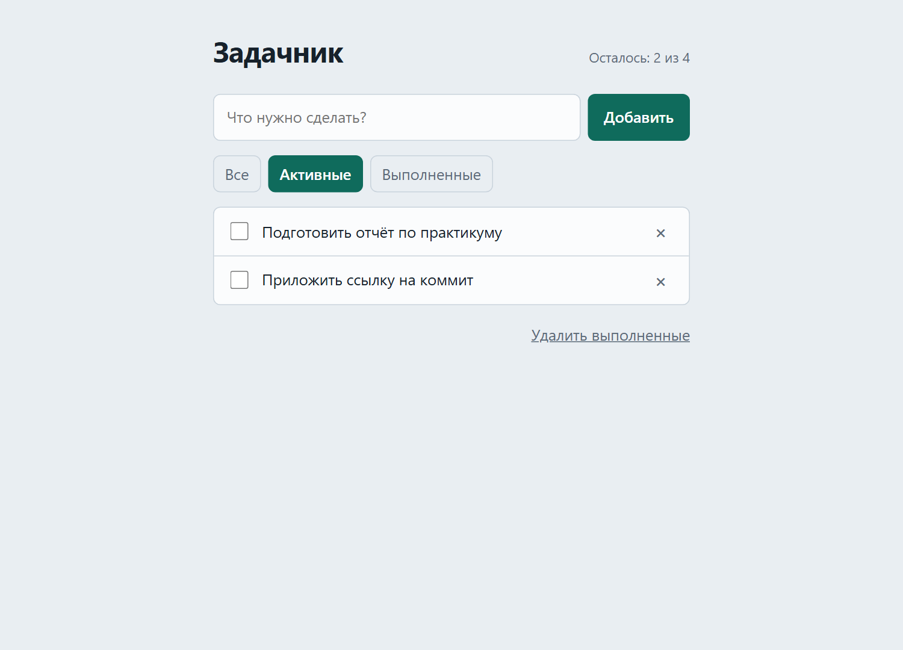
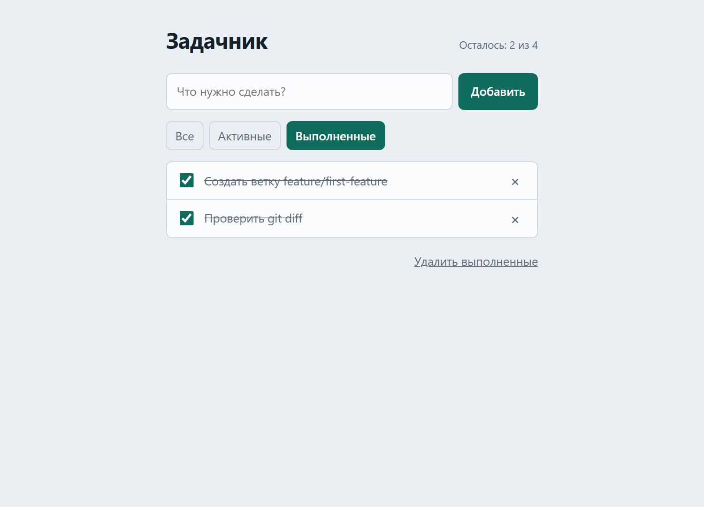

# Отчёт по практикуму 2

## Репозиторий и ветка

- Репозиторий: [gansik0909090990-del/zadachnik](https://github.com/gansik0909090990-del/zadachnik)
- Ветка разработки: `feature/first-feature`
- Итоговая ветка: `main`
- Коммит функции: [`30d4477`](https://github.com/gansik0909090990-del/zadachnik/commit/30d44772a08aa6cd236a22a33fc571edc8f16425)

## Как выполнялась работа

1. Проверено состояние репозитория и выполнена синхронизация `main`.
2. Создана ветка `feature/first-feature`.
3. Для ИИ был выбран один сценарий: фильтрация задач.
4. До реализации были определены затрагиваемые файлы: `index.html`, `app.js`, `style.css` и `README.md`.
5. После реализации изменения изучены через `git diff` и `git status`.
6. Выполнены проверка синтаксиса JavaScript и запуск страницы в Chrome.
7. Создан предметный коммит `feat: add task filters`.
8. Ветка объединена с `main` методом fast-forward.
9. Версия из `main` повторно проверена и отправлена на GitHub.

## Запрос к ИИ

Реализовать только фильтрацию задач по состоянию: «Все», «Активные» и «Выполненные». Сначала перечислить затрагиваемые файлы, затем предложить три ручные проверки и одну возможную пользовательскую ошибку. Не изменять файлы, которые не относятся к выбранному сценарию.

Предложенные проверки:

1. Переключение между всеми тремя фильтрами.
2. Обновление списка после изменения состояния задачи.
3. Сохранение выбранного фильтра после перезагрузки.

Возможная пользовательская ошибка: пользователь может принять скрытые фильтром задачи за удалённые. Поэтому при пустом результате выводится сообщение «В этом разделе задач пока нет».

## Сценарий до и после

**До изменения:** все задачи отображались одним списком. Отдельно посмотреть активные или выполненные задачи было нельзя.

**После изменения:** пользователь может выбрать «Все», «Активные» или «Выполненные». В списке остаются только подходящие задачи, а выбранный режим сохраняется после перезагрузки страницы.

## Изменённые файлы

- `index.html` — добавлены кнопки фильтров.
- `app.js` — добавлены фильтрация и сохранение выбранного режима.
- `style.css` — оформлено активное состояние кнопок и перенос на узких экранах.
- `README.md` — обновлены возможности и ручные проверки.

Изменение функции содержало 66 добавлений и 3 удаления в четырёх файлах.

## Подтверждение работы

### Фильтр «Активные»

Отображаются только две незавершённые задачи. Активная кнопка выделена цветом.

### Фильтр «Выполненные»

Отображаются только две завершённые задачи с отметками и зачёркнутым текстом.

## Коммиты и слияние

- Исходный коммит `main`: `aae873ced2109a2dabe227b0014ab5434a289673`.
- Коммит разработки: `30d44772a08aa6cd236a22a33fc571edc8f16425`.
- Сообщение: `feat: add task filters`.
- Способ слияния: fast-forward merge.
- Отдельный merge-коммит не создавался; после слияния `main` указывал на коммит `30d4477`.

## Обнаруженная проблема

При запрете доступа к `localStorage` прямое чтение сохранённого фильтра могло остановить выполнение приложения. Доступ к хранилищу был обёрнут в обработку ошибок. Теперь при недоступном хранилище приложение продолжает работать с фильтром «Все».

Дополнительно кнопкам фильтров добавлен перенос строк для корректного отображения на узких экранах.

## Самопроверка

- [x] Функция выполняется полностью.
- [x] Работа велась в ветке `feature/first-feature`.
- [x] Изменения изучены через `git diff` и `git status`.
- [x] Создан предметный коммит разработки.
- [x] В `main` находится работоспособная версия.
- [x] После слияния проект повторно запущен.
- [x] Изменения отправлены на GitHub.
- [x] Указаны ссылка, ветка, сценарий до/после, проверки, хеши, способ слияния и обнаруженная проблема.
